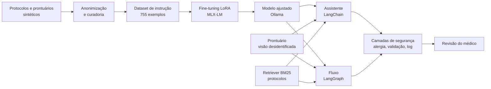

# Arquitetura

O sistema é um apoio ao médico, não um sistema que decide sozinho. Toda saída fica marcada como "aguardando validação médica", e a decisão final é sempre de uma pessoa.

## Módulos

| Pasta | Responsabilidade |
|---|---|
| `data/` | protocolos, base sintética, anonimização, curadoria e montagem do dataset |
| `finetune/` | treino LoRA, retomada de checkpoint e fusão do adapter |
| `assistant/` | prontuário desidentificado, retriever, ferramentas, formato do prompt e a chain |
| `safety/` | regra de alergia, validação da saída, classificação da entrada, log de auditoria e o `AssistenteSeguro` |
| `graph/` | fluxo do paciente em LangGraph, regras de alerta e fila de alertas |
| `evaluation/` | conjuntos de teste, métricas, geradores dos quatro sistemas e relatório |

## Decisões de arquitetura

O modelo escreve, o código decide. O código acha o paciente, busca o protocolo, calcula as listas de exames e alergias, decide os alertas e valida a saída. O modelo só escreve texto com o que recebeu. A razão está medida: ele erra alguma lista do prontuário em cerca de 39% das respostas.

Conhecimento no prompt, comportamento nos pesos. Mudar um protocolo é mudar um texto. O fine-tuning ensina a citar a fonte, recusar prescrição e dizer "não encontrei". O formato do prompt é o mesmo código no treino e no uso, e um teste confere isso nos 240 exemplos com paciente.

BM25 em vez de embeddings. Com 10 protocolos, um banco vetorial não se paga. O BM25 dá a nota, o protocolo e o campo de cada trecho, e isso alimenta a explicabilidade.

Fluxo fixo em vez de agente. A chain não deixa o modelo escolher quando consultar o prontuário. Um modelo de 1,5B decidindo isso seria um ponto frágil na parte de segurança. A chain usa a ferramenta `consultar_paciente` (um `@tool` do LangChain) pra montar o contexto do prompt. `listar_exames_pendentes` e `buscar_protocolo` existem e têm teste, mas nenhum agente as chama neste projeto. O fluxo do LangGraph chama direto as funções de `prontuario.py`.

Revisão humana é um estado do grafo. O fluxo pausa em `revisao_humana` (`interrupt`) e só segue com a decisão de um médico identificado. Sem decisão, o plano nunca vira final.

## Fluxo de uma pergunta

1. A pergunta chega, e o código procura um ID de paciente (`P-0007`).
2. O prontuário é lido já desidentificado: ID, idade, sexo, queixa, alergias, medicações e exames.
3. O retriever escolhe o protocolo e o trecho. Sem termo de identidade na pergunta, não devolve nada, e o modelo diz que não encontrou.
4. O prompt é montado no formato do treino e vai pro modelo no Ollama.
5. A regra de alergia e a validação conferem a resposta. Se reprovar, entra a resposta segura (protocolo sem alteração).
6. A consulta vira uma linha no log encadeado, com o que o modelo disse e o que saiu.

## Execução e escala

Tudo roda local: o modelo no Ollama, o prontuário em SQLite, o log e a fila de alertas em arquivos JSONL. Cada consulta leva em média 2,5 segundos no M4. Não há deploy em nuvem, como na fase 2.

Pra um hospital de verdade, três pontos teriam que mudar: o checkpointer do fluxo (hoje em memória) por um persistente, a fila de alertas por um sistema de plantão e o log por um armazenamento que grave o último hash fora do arquivo.
