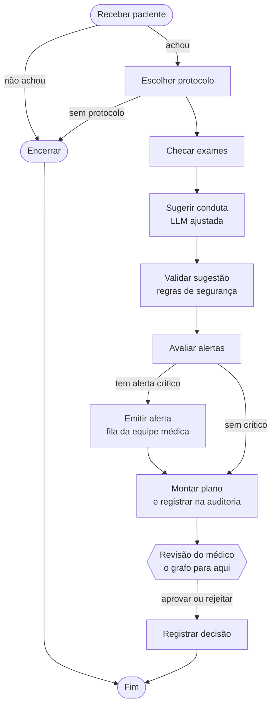

# Fluxo automatizado com LangGraph

O enunciado fala em fluxos em que, ao receber informações de um paciente, o sistema aciona etapas sozinho: verificar exames pendentes, sugerir tratamento e emitir alertas pra equipe médica. Isso está em `graph/fluxo.py`, feito com LangGraph.



O diagrama sai do próprio código com `python -m hospital_assistant.graph --mermaid`.

O que é decidido por código e o que é do modelo. Os alertas são regras (`graph/regras.py`), não opinião do modelo: resultado de exame alterado, alergia contra algo que a conduta do protocolo cita (a conduta de embolia pulmonar pede angiotomografia, que usa contraste iodado, e o paciente é alérgico a iodo), exame pendente, exame que o protocolo prevê e o prontuário não tem. As listas de exames e de alergias que aparecem no plano também são calculadas por código, pelo motivo descrito em [security.md](security.md): o modelo erra essas listas. Ele só entra com a sugestão de conduta, e ela passa pela mesma validação de segurança.

Alerta crítico muda o caminho. Resultado alterado e conflito direto de alergia são críticos: o fluxo passa por `emitir_alerta`, que manda pra fila da equipe (`logs/alertas.jsonl` no protótipo, um sistema de plantão num hospital de verdade) antes de montar o plano. Sem alerta crítico, o grafo pula essa etapa.

O grafo para no médico. Em `revisao_humana` o grafo faz uma pausa (`interrupt` do LangGraph) e guarda o estado. Só continua quando o médico decide `aprovar` ou `rejeitar`, e precisa se identificar. Se a decisão vier inválida ou sem nome de médico, o fluxo rejeita: na dúvida, não aprova. Ninguém consegue decidir duas vezes no mesmo fluxo. Sem decisão, o plano fica "aguardando validação médica" pra sempre e nunca vira final.

Se o modelo cair, o fluxo continua. Se o Ollama estiver fora do ar, o passo da sugestão registra "LLM indisponível" e o plano sai com o texto do protocolo sem alteração, mais os dados do prontuário calculados por código.

Auditoria. O fluxo grava dois eventos no mesmo log encadeado: `fluxo_gerado` (alertas, o que o modelo disse, a decisão da validação, os passos e o hash do plano) e `decisao_medica` (quem decidiu, o quê, e o mesmo hash do plano). O hash igual nos dois mostra que o médico decidiu sobre aquele plano. Fluxo encerrado (paciente não achado) também fica registrado.

Pra rodar:

```bash
.venv/bin/python -m hospital_assistant.graph P-0038
.venv/bin/python -m hospital_assistant.graph P-0038 --medico "Dra. Demo" --decisao aprovar
```

Sem `--decisao`, o terminal pergunta. O P-0038 mostra bem o caminho crítico: alérgico a iodo, com resultado alterado na angiotomografia.
